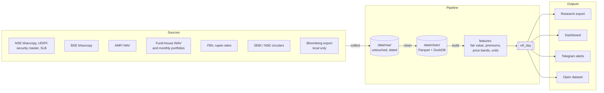

# India ETF Premium Tracker

**How far above their real value do India-listed international ETFs trade, and why?**

A research data pipeline, live tracker and open dataset for Indian ETFs that hold US and Hong Kong stocks. These funds have been unable to issue new units since India's mutual funds hit their overseas investment limits. Since then, buying pressure has pushed their market prices well above the value of what they hold.

[](https://www.python.org/)
[](https://github.com/astral-sh/uv)
[](#testing)
[](https://github.com/astral-sh/ruff)
[](LICENSE)

> **For research and information only. Not investment advice.** Figures may contain errors; check official NSE and AMFI data before acting.

---

## Contents

- [The story in 60 seconds](#the-story-in-60-seconds)
- [What this project produces](#what-this-project-produces)
- [How it works](#how-it-works)
- [The numbers it computes](#the-numbers-it-computes)
- [ETFs covered](#etfs-covered)
- [Quick start](#quick-start)
- [Commands](#commands)
- [Repository layout](#repository-layout)
- [Design principles](#design-principles)
- [Data sources](#data-sources)
- [Status and known limitations](#status-and-known-limitations)
- [Documentation](#documentation)
- [License and data terms](#license-and-data-terms)

---

## The story in 60 seconds

An **ETF** (exchange-traded fund) is a basket of assets that trades on a stock exchange like a single share. Every ETF has a **NAV** (net asset value), which is what its holdings are actually worth per unit. Normally the market price stays close to the NAV. When the price rises above the NAV, big market participants create new units at NAV and sell them at the higher price. That pulls the price back down. This is called **arbitrage**, and it acts as a pressure valve.

For India's international ETFs, **the valve is shut**:

1. **Creation is blocked.** SEBI caps how much Indian mutual funds can invest abroad. Once the industry hit that cap, these ETFs stopped creating new units, so extra demand can only push the price up. The gap between price and value is called the **premium**.
2. **Price bands changed in September 2026.** NSE limits how far an ETF's price can move in a day. Until 4 Sep 2026 the limit was ±20% around the NAV from two days earlier, which kept the premium near 20%. From 7 Sep 2026 the band is anchored to the **previous day's closing price** instead. A capped price can now ratchet up day after day, and premiums jumped from about 20% to **over 200%**.
3. **The anchor moves back on 1 April 2027.** Bands are planned to be anchored to NAV again, which caps the premium near 20%. Anyone holding at a 200% premium is exposed to that reset.

This project records the episode as it happens, carefully enough for an empirical finance paper, and publishes the data so others can check it.

```
Premium = (Market price ÷ Fair value) − 1

   Price ₹300, fair value ₹100  →  premium = 200%
```

---

## What this project produces

One clean, tested table (`etf_day`: one row per ETF per trading day) feeds three outputs:

| Output | What it is | Built by |
|---|---|---|
| **Research paper** | Empirical finance analysis of premiums, price limits and blocked arbitrage | `etfp export research`, a versioned snapshot with a data dictionary and manifest |
| **Live premium tracker** | Streamlit dashboard plus Telegram alerts | `dashboard/app.py`, `etfp alerts` |
| **Open dataset** | Cleaned data plus code, intended for publication with a DOI | `etfp export dataset` |

---

## How it works



**Each stage has one job:**

1. **Collect.** One module per source. `fetch()` downloads and saves the file **untouched** under `data/raw/<source>/<YYYY-MM-DD>/`. `parse()` turns a saved file into a typed DataFrame. Network code and parsing are kept apart, so every parser is tested against real saved files.
2. **Clean.** Reads raw files, never edits them, and writes Parquet tables. Every row keeps a `source_file` column pointing back to the raw file it came from.
3. **Features.** Fair value, the premium measures, the official and computed price bands, units outstanding and creation events.
4. **Export.** Versioned snapshots with `manifest.json` (git commit, build time in IST, row counts, data-quality flag counts, open questions, `schema_version`) and a `DATA_DICTIONARY.md` that documents every column.

Scheduling uses macOS `launchd`. iNAV snapshots run every 15 minutes during market hours. A daily evening run and a next-morning run pick up overseas NAVs, which are published after the Indian market closes. See [`docs/OPERATIONS.md`](docs/OPERATIONS.md).

---

## The numbers it computes

### Fair value: what the ETF is worth at the Indian close

A US-linked ETF's NAV for day *t* uses the US close, about 10 hours **after** the Indian market shuts. Comparing today's Indian price with that NAV mixes two different moments. Fair value fixes this. It starts from the latest NAV known at 15:30 IST and moves it forward using index futures and the exchange rate:

```
FV_t = NAV_a × (F_t at 15:30 IST ÷ F at US close of a) × (S_t at 15:30 IST ÷ S_a)

  NAV_a  latest NAV known at the Indian close (struck on underlying date a)
  F      front-month index future (E-mini Nasdaq-100 / S&P 500)
  S      USD/INR or HKD/INR
```

Worked example (a unit test): NAV 100, futures 20,000 → 20,200, rupee 84.00 → 84.42 gives FV = 100 × 1.01 × 1.005 = **101.505**.

### Premium measures (all stored, because each answers a different question)

| Column | Formula | Use |
|---|---|---|
| `prem_raw` | close ÷ NAV of same date − 1 | The figure the press quotes (mixes timings) |
| `prem_nav_known` | close ÷ NAV known at close − 1 | No look-ahead: only information available at 15:30 IST |
| `prem_fv` | close ÷ fair value − 1 | Main research measure |
| `prem_band_ref` | close ÷ NAV(T−2) − 1 | What the pre-September band actually constrained |
| `prem_inav` | last price ÷ iNAV − 1 | Intraday snapshots |
| `x_april` | ln(close ÷ (1.2 × FV)) | How far the price sits above the post-April-2027 ceiling (> 0 means above it) |

### Price-band regimes (data-driven, in `config/rules.yaml`)

| Regime | Dates | Band anchored to | Equity ETF band |
|---|---|---|---|
| `nav_t2` | until 4 Sep 2026 | NAV from 2 trading days earlier | fixed ±20% |
| `prev_close` | 7 Sep 2026 to 31 Mar 2027 | previous day's close | ±10%, widens in 5% steps after a cooling-off, max ±20% |
| `nav_t1` | from 1 Apr 2027 (planned) | previous day's NAV | same dynamic band |

The band calculator was reverse-engineered against NSE's **official** published bands, including paisa rounding, special sessions, Muhurat (Diwali) sessions and the fallback used when a NAV is missing. On pre-September 2026 days, mismatches against NSE's official bands fell from 414 rows to 20.

### Is the valve open?

Units outstanding come from NSE's daily security master (from Feb 2024) and the fund houses' monthly portfolios (from 2021). A rise of at least one creation block (the fixed number of units a fund creates or cancels at a time) means the fund created units that month. `valve_monthly` records the status for every ETF and month, together with the raw numbers behind it.

---

## ETFs covered

**Treated group: international ETFs that cannot create units freely**

| Symbol | Tracks | Fund house |
|---|---|---|
| MONQ50 | Nasdaq Q-50 | Motilal Oswal |
| MON100 | Nasdaq-100 | Motilal Oswal |
| MASPTOP50 | S&P 500 Top 50 | Mirae Asset |
| MAFANG | NYSE FANG+ | Mirae Asset |
| MAHKTECH | Hang Seng TECH | Mirae Asset |
| HNGSNGBEES | Hang Seng Index | Nippon India |

**Control group:** 22 liquid domestic equity ETFs from 9 fund houses, tracking 12 indices (Nifty 50, Nifty Bank, Midcap 150, Sensex and others). They follow the same price-band rules but can create units freely, which is what makes them useful for comparison.

**Also tracked:** gold and silver ETFs (GOLDBEES, SILVERBEES) and the feeder funds (funds of funds) that buy the international ETFs on the exchange.

The full list and its metadata are in [`config/etfs.yaml`](config/etfs.yaml).

---

## Quick start

Requires **Python 3.11+** and [**uv**](https://github.com/astral-sh/uv).

```bash
git clone https://github.com/AmishhYadav/ETF_Premiums.git
cd ETF_Premiums

uv sync --all-extras          # pipeline + dashboard + iNAV browser capture
cp .env.example .env          # optional: Telegram token for alerts

uv run pytest -q              # 1,567 tests, runs on saved fixtures, no network needed

# Pull one day, build, and look at it
uv run etfp collect daily --date 2026-11-19
uv run etfp build
uv run streamlit run dashboard/app.py
```

To build the full history from 2021, run `uv run etfp backfill --from 2021-01-01`. It is resumable and rate-limited, so expect it to take a while.

---

## Commands

```bash
uv run etfp collect daily --date YYYY-MM-DD   # download every daily source for a date
uv run etfp collect inav                      # one intraday iNAV snapshot
uv run etfp backfill --from 2021-01-01        # historical download, resumable
uv run etfp build                             # raw → clean → features → research export
uv run etfp alerts                            # evaluate alert rules, send to Telegram
uv run etfp status                            # recorder heartbeat and today's file counts

uv run etfp export research                   # versioned snapshot for analysis
uv run etfp export dataset                    # open-dataset package
uv run etfp bloomberg check                   # validate a Bloomberg export before import

uv run streamlit run dashboard/app.py         # dashboard
uv run ruff check . && uv run ruff format .   # lint and format
```

Run `uv run etfp --help` or `uv run etfp <command> --help` for every option.

---

## Repository layout

```
config/            ETF universe, price-band regimes, alert rules, holidays, feeders
src/etfp/
  collect/         one module per source: fetch() saves raw, parse() returns a DataFrame
  clean/           raw → clean Parquet tables, with lineage
  features/        fair value, premiums, price bands, units, valve status
  alerts/          alert rules and Telegram sender
  cli.py           `etfp` command-line entry point
dashboard/         Streamlit app
tests/             unit tests and real-file fixtures
docs/              spec, decision log, operations runbook, research handoff
data/manual/       hand-entered tables (events, monthly units), with sources
data/raw/          untouched downloads              (gitignored)
data/clean/        Parquet tables + etf.duckdb      (gitignored)
exports/           research and dataset snapshots   (gitignored)
paper/             research paper drafts and their analysis scripts
```

---

## Design principles

- **Raw data is immutable.** Every download is saved exactly as received, under a dated folder. Cleaning reads raw files and never writes back to them.
- **Every number is traceable.** Each clean row carries the path of the raw file it came from.
- **Correctness first.** Fair value, price bands and units are research-critical. Each has unit tests with hand-computed examples, plus regression tests against NSE's official figures.
- **Time is explicit.** Dates are ISO `YYYY-MM-DD`. Timestamps are timezone-aware (`Asia/Kolkata`, `America/New_York`, `Asia/Hong_Kong`). Naive datetimes are a lint error (ruff `DTZ`).
- **No look-ahead.** Columns used for research only use information that was public at the Indian close. Rows that would leak later NAVs are flagged.
- **Fail loudly.** If a source changes format or blocks access, the run stops with a message naming the source and date. Nothing is skipped silently.
- **Polite to sources.** At least 1 second between NSE requests, caching, retries with backoff, and a network breaker that stops when connections keep failing.
- **Decisions are written down.** Every judgement call and every checked assumption is logged in [`docs/DECISIONS.md`](docs/DECISIONS.md).

---

## Data sources

| Source | What it gives |
|---|---|
| NSE | Daily bhavcopy (prices, volume, delivery), UDiFF, security master (units outstanding), official price bands, securities lending, circulars |
| BSE | Daily prices and volumes (combined with NSE for turnover) |
| AMFI | Daily NAV for every scheme |
| Fund houses (Mirae, Motilal, Nippon) | Intraday iNAV, monthly portfolios (units, feeder holdings), scheme documents |
| FBIL | Reference USD/INR rate |
| SEBI | Circulars and regulatory events |
| Bloomberg | Futures, FX and minute bars for research; **never committed** (licence) |

---

## Status and known limitations

The pipeline, the clean table, the dashboard, alerts, the research export and the dataset export are built and tested. The open items:

- **Futures-based fair value is waiting for data.** Free futures sources currently block automated access, so fair value falls back to the latest known NAV (`fv_method = nav_only`) until Bloomberg data is imported.
- **Intraday order-book depth** is only available from NSE's quote page. Capture for it is written but has not been confirmed in a live market session yet.
- **Motilal's iNAV for MON100 and MONQ50** moves only with the exchange rate, by the fund house's own definition. It is recorded but not trusted as a measure of value.
- **The April 2027 regime** is SEBI's stated target, not a final rule. It lives in config, so it can change without code changes.

Every unconfirmed item is listed under "Open VERIFY items" in [`docs/DECISIONS.md`](docs/DECISIONS.md).

---

## Documentation

| File | What's in it |
|---|---|
| [`docs/SPEC.md`](docs/SPEC.md) | Full technical specification (source of truth) |
| [`docs/DECISIONS.md`](docs/DECISIONS.md) | Every decision, check against live sources and open question, numbered |
| [`docs/OPERATIONS.md`](docs/OPERATIONS.md) | How the scheduled runs work and what to do when one fails |
| [`docs/RESEARCH_HANDOFF.md`](docs/RESEARCH_HANDOFF.md) | Export format and schema changes, for the analysis side |
| [`docs/VALVE_STATUS.md`](docs/VALVE_STATUS.md) | Month-by-month creation status per ETF |
| [`docs/REQUESTS.md`](docs/REQUESTS.md) | Data requests from the research side and their status |
| [`docs/manual_data.md`](docs/manual_data.md) | How hand-entered tables are sourced and validated |

---

## License and data terms

The **code** is released under the [MIT License](LICENSE).

The **data** is not covered by that licence. Raw files from NSE, BSE, AMFI, fund houses and Bloomberg remain subject to their providers' terms. Raw downloads are not committed to this repository, and Bloomberg data is never redistributed. Check each provider's terms before reusing derived figures.

---

<sub>Built by Amish Yadav as part of an empirical finance research project on India's international ETF premiums.</sub>
